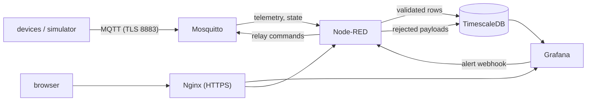
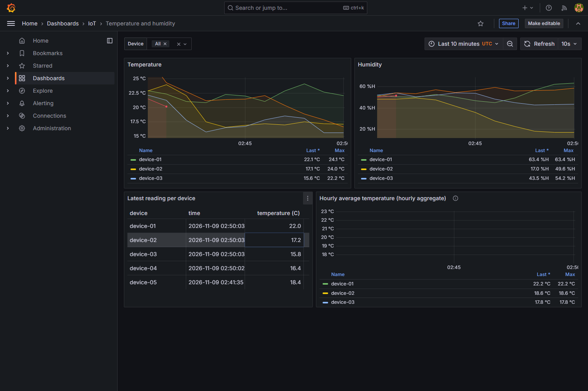
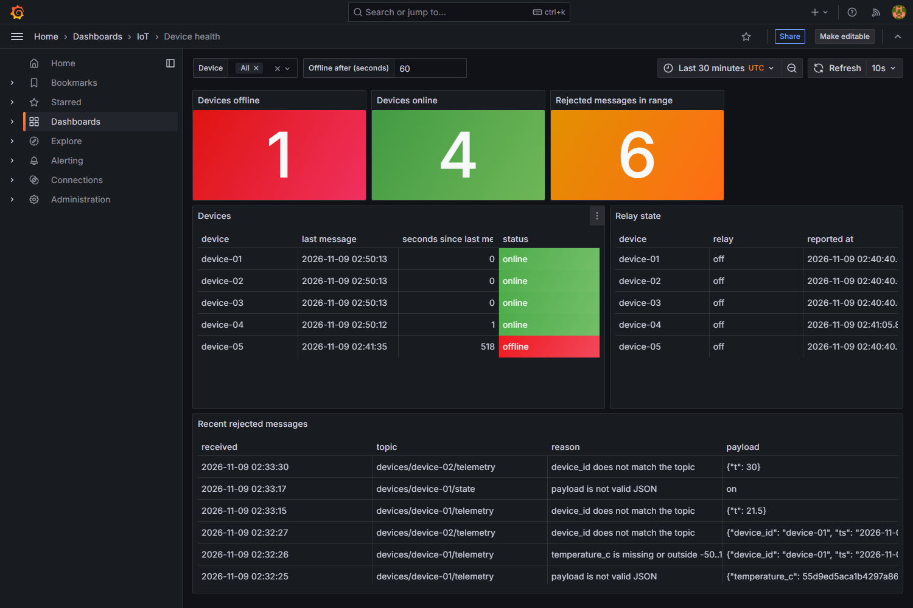
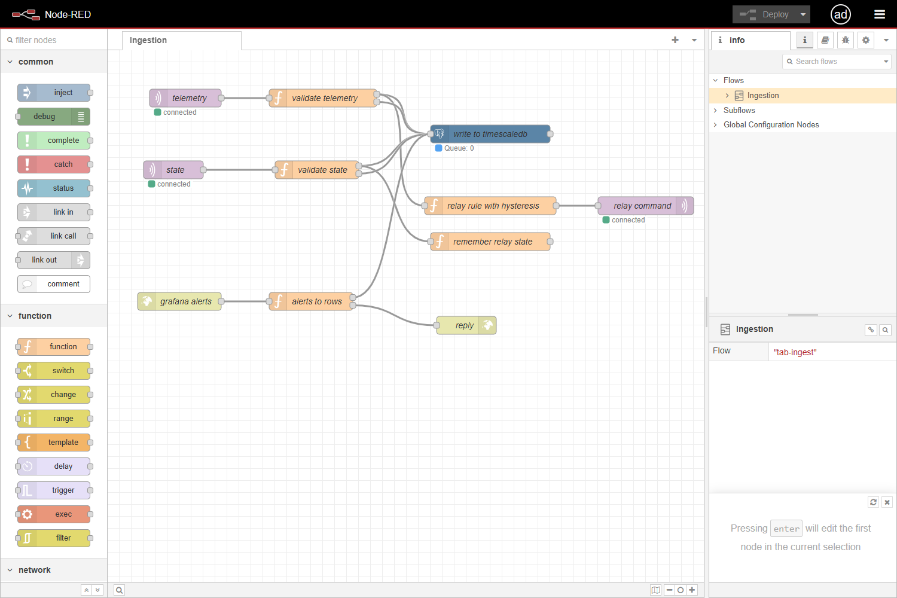

# self-hosted-iot

A self-hosted IoT platform that runs entirely on your own hardware with Docker Compose: MQTT messaging, rule-based automation, time-series storage and dashboards, without any commercial IoT cloud.

> **Status:** working end to end on x86-64 with Docker Compose and a device simulator. Not yet measured on a real Raspberry Pi (see the roadmap).

## Purpose

Show how to build and operate an IoT backend on-premises, from device messaging to dashboards, on low-cost hardware such as a Raspberry Pi. A device simulator is included so the whole stack can be developed and tested without physical devices. All data is generated.

## Architecture



Devices publish JSON telemetry to `devices/<id>/telemetry` and state to `devices/<id>/state`. Node-RED subscribes as the `service` user, validates every message, writes valid readings to a TimescaleDB hypertable and everything else to a rejected-messages table. A rule compares each reading with two temperature thresholds and publishes relay commands back to the device. Grafana reads the database, shows dashboards and raises an alert that is delivered to Node-RED through a webhook.

## Screenshots

Captured from the running stack with the simulator publishing five devices (`device-05` was stopped on purpose, so it shows as offline).







## Quickstart

Requirements: Docker with Compose v2, Bash, OpenSSL and Python 3.11 or newer (only for the simulator and the tests).

```bash
cp .env.example .env
bash scripts/generate-certs.sh
bash scripts/create-mqtt-users.sh device-01 device-02 device-03 device-04 device-05
docker compose up -d --build --wait
```

Open `https://127.0.0.1:21443/grafana/` and sign in with the Grafana credentials from `.env`. The certificate is self-signed: either accept the warning or trust `certs/ca.crt`. The Node-RED editor is at `https://127.0.0.1:21443/nodered/`.

Start the simulator against the encrypted listener:

```bash
python -m venv .venv
.venv/bin/pip install -r requirements-dev.txt
set -a; . .secrets/mqtt-credentials.env; set +a
MQTT_PORT=21884 MQTT_TLS_CA=certs/ca.crt SIM_DEVICES=device-01,device-02,device-03 \
  SIM_INTERVAL_SECONDS=2 .venv/bin/python -m simulator
```

On Windows use `.venv/Scripts/python` instead. Stop the stack with `docker compose down`; add `-v` to delete the data volumes as well.

### Services and ports

All host ports are bound to `127.0.0.1` and can be changed in `.env`.

| Service | Purpose | Host port |
|---|---|---|
| `mosquitto` | MQTT broker, plain on 1883 and TLS on 8883 inside the container | 21883, 21884 |
| `timescaledb` | PostgreSQL 16 with TimescaleDB | 21432 |
| `nodered` | ingestion, validation and rules (not published) | none |
| `grafana` | dashboards and alerts (not published) | none |
| `nginx` | HTTPS reverse proxy for Grafana and Node-RED, plain HTTP redirects to HTTPS | 21443, 21080 |
| `migrate` | one-shot job that applies the SQL migrations | none |

### Configuration

| Variable | Default | Meaning |
|---|---|---|
| `MQTT_PORT`, `MQTT_TLS_PORT` | `21883`, `21884` | host ports of the broker |
| `POSTGRES_USER`, `POSTGRES_DB`, `POSTGRES_PASSWORD`, `POSTGRES_PORT` | `iot`, `iot`, development value, `21432` | database settings |
| `GRAFANA_ADMIN_USER`, `GRAFANA_ADMIN_PASSWORD` | `admin`, development value | Grafana administrator |
| `NODE_RED_ADMIN_USER`, `NODE_RED_ADMIN_PASSWORD` | `admin`, development value | Node-RED editor login |
| `HTTP_PORT`, `HTTPS_PORT`, `PUBLIC_BASE_URL` | `21080`, `21443`, `https://127.0.0.1:21443` | proxy ports and the URL Grafana uses to build links |
| `TEMP_HIGH_C`, `TEMP_LOW_C` | `28`, `25` | relay switches on at or above the first and off at or below the second |

The passwords in `.env.example` are placeholders for local development. Change them before exposing anything.

## Data flow

### MQTT access model

Anonymous access is disabled. Topic permissions live in `mosquitto/config/acl`:

| User | Can publish | Can read |
|---|---|---|
| `device-NN` | `devices/device-NN/telemetry`, `devices/device-NN/state` | `devices/device-NN/commands` |
| `service` | `devices/+/commands` | `devices/+/telemetry`, `devices/+/state` |

`scripts/create-mqtt-users.sh` creates the `service` user and one user per device with random passwords, writes the hashed password file used by Mosquitto, and saves the plain credentials to `.secrets/mqtt-credentials.env` and the broker login used by Node-RED to `.secrets/nodered.env`. These files and the password file are ignored by git.

Mosquitto's built-in ACL does not reject a subscription to a topic the client cannot read: the subscription is acknowledged and the read permission is enforced when messages are delivered. The tests therefore check that nothing is delivered, with a positive control, rather than expecting a rejected subscription.

### Device simulator

`python -m simulator` runs one or more fake devices. Each device connects with its own credentials, publishes temperature and humidity readings as JSON on `devices/<id>/telemetry`, subscribes to `devices/<id>/commands`, and publishes its state on `devices/<id>/state` when it connects and after every valid command.

| Variable | Default | Meaning |
|---|---|---|
| `SIM_DEVICES` | `device-01` | comma-separated device ids |
| `MQTT_PASSWORD_<ID>` | required | password of each device (`device-01` becomes `MQTT_PASSWORD_DEVICE_01`) |
| `MQTT_HOST`, `MQTT_PORT` | `127.0.0.1`, `21883` | broker address |
| `MQTT_TLS_CA` | unset | path of the CA certificate; setting it turns TLS on |
| `SIM_INTERVAL_SECONDS` | `5` | seconds between readings |
| `SIM_SEED` | `0` | seed of the random walk, so runs are reproducible |
| `SIM_BASE_TEMPERATURE_C` | `22` | starting temperature of every device |

A telemetry message looks like `{"device_id": "device-01", "ts": "2030-01-01T12:00:00+00:00", "temperature_c": 22.13, "humidity_pct": 49.8}`. The relay command is `{"relay": "on"}` or `{"relay": "off"}`; anything else is ignored. With the relay on, the simulated temperature drifts down.

### Storage

SQL migrations in `db/migrations` are applied in order by the `migrate` service and recorded in `schema_migrations`, so `docker compose up` brings an empty database to the current schema and re-running it changes nothing.

| Object | Description |
|---|---|
| `readings` | hypertable partitioned by day, unique per device and timestamp, range checks on temperature and humidity |
| `device_states` | last relay state reported by each device |
| `rejected_messages` | hypertable with the topic, original payload and reason of every discarded message |
| `alert_events` | alerts received from Grafana |
| `readings_5m`, `readings_1h` | continuous aggregates with real-time results, refreshed by policies |

Readings are compressed after 7 days (segmented by device) and dropped after 90 days; rejected messages are dropped after 30 days. The policies can be listed with `SELECT * FROM timescaledb_information.jobs`.

### Ingestion and validation

The Node-RED flow in `nodered/flows.json` is versioned in the repository and mounted read-only; the code behind the function nodes lives in `nodered/lib` and is covered by unit tests. A message is rejected, and stored with the reason, when the payload is not a JSON object, the `device_id` differs from the topic, the timestamp is missing, malformed or more than a day in the future, or a value is outside its physical range.

### Rules and alerts

The relay rule uses hysteresis: a device is told to switch the relay on when a reading reaches `TEMP_HIGH_C` and off only when a reading falls to `TEMP_LOW_C` or below, so readings that hover around one threshold do not make it oscillate. The relay state is taken from what the device reports.

Grafana provisions an alert rule (`High temperature`, any device above 32 C in the last minute) and a webhook contact point that posts to a Node-RED endpoint, which stores the notification in `alert_events`. The endpoint is only reachable inside the Compose network.

### Dashboards

Dashboards and the data source are provisioned as code from `grafana/`. *Temperature and humidity* has a device selector, the time range picker and a panel that reads the hourly aggregate. *Device health* lists the last message of every device and marks it offline when nothing arrived for the configured number of seconds (60 by default).

## Security notes

- MQTT: authentication and per-device ACLs are always on. A TLS listener (TLS 1.2 and later) is available on the second MQTT port. The plain listener stays enabled for local tests and is bound to the loopback interface; traffic between containers is not encrypted.
- Web: only Nginx is published, over HTTPS with a self-signed certificate generated by `scripts/generate-certs.sh` (the files go to `certs/` and are ignored by git). Plain HTTP is redirected.
- Node-RED: the editor requires a login. The MQTT credentials Node-RED needs are written to its data volume as an unencrypted credentials file, so the volume and the backups must be treated as secrets.
- Database: PostgreSQL is published on the loopback interface for convenience; remove that port mapping if you do not need it.

## Backup and restore

```bash
bash scripts/backup.sh                              # writes backups/<UTC timestamp>/
bash scripts/restore.sh backups/<name> --database iot_restored
bash scripts/restore.sh backups/<name> --database iot_restored --volumes
```

A backup holds a custom-format `pg_dump` of the database, one archive per data volume and a checksum file that `restore.sh` verifies first. The database is restored into an empty database (it is created when missing, and a database that already has tables is refused), using the TimescaleDB pre and post restore steps. `--volumes` also unpacks the volume archives over the stack's volumes, so stop the stack first.

## Tests

```bash
python -m venv .venv
.venv/bin/pip install -r requirements-dev.txt
.venv/bin/ruff check . && .venv/bin/ruff format --check .
.venv/bin/pytest
(cd nodered && node --test)
```

The unit tests need nothing running: the simulator logic with a fake MQTT client, and in `nodered/test` the validation, hysteresis and alert parsing code and the structure of `flows.json`. The integration tests in `tests/` talk to the running stack and are skipped with an explanatory message when a service or the credentials are missing. They cover broker authentication and ACLs, the schema, migrations from scratch, retention and compression, aggregates, ingestion with the simulator, the relay rule, the Grafana data source, dashboards and alert, the proxy, TLS, Node-RED authentication and backup and restore. Some of them (alert delivery, the relay cycle) wait for real events and take a minute. Besides the broker credentials created by the quickstart, the tests read `.env` or `.env.example` for the other settings.

CI (`.github/workflows/ci.yml`) runs the linters and unit tests, validates the Compose file, runs the broker tests against the Mosquitto service and runs the whole suite against the full stack.

## Supported architectures

Every image used by the Compose file publishes manifests for both x86-64 and ARM64, so the same configuration should run on a Raspberry Pi 4 or 5 (64-bit OS) and on a regular PC. The table is produced by `bash scripts/check-architectures.sh`, which reads the registry manifests and exits with an error when an image lacks one of the two platforms.

| Image | linux/amd64 | linux/arm64 |
|---|---|---|
| `eclipse-mosquitto:2` | yes | yes |
| `timescale/timescaledb:2.17.2-pg16` | yes | yes |
| `nodered/node-red:4.0.5` | yes | yes |
| `grafana/grafana:11.3.0` | yes | yes |
| `nginx:1.27-alpine` | yes | yes |
| `alpine:3.20` (backup helper) | yes | yes |

The manifests were verified; the stack itself has only been run on x86-64. The Node-RED image is built locally from the official one and adds a pure JavaScript package, so it needs no architecture-specific build step.

## Roadmap

- [x] 1. Compose skeleton with an authenticated Mosquitto broker
- [x] 2. Device simulator
- [x] 3. TimescaleDB storage and Node-RED ingestion flow
- [x] 4. Grafana dashboards provisioned as code
- [x] 5. Alert rules and commands back to devices
- [x] 6. Nginx with TLS, backups and documentation
- [ ] 7. Run on a real Raspberry Pi and record memory usage

## Stack

Docker Compose, Eclipse Mosquitto, Node-RED, PostgreSQL with TimescaleDB, Grafana, Nginx, Python, GitHub Actions.

## License

Released under the [MIT License](LICENSE).
